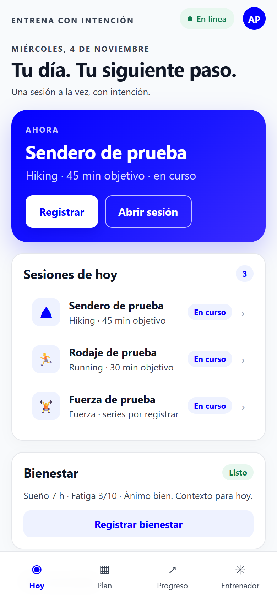
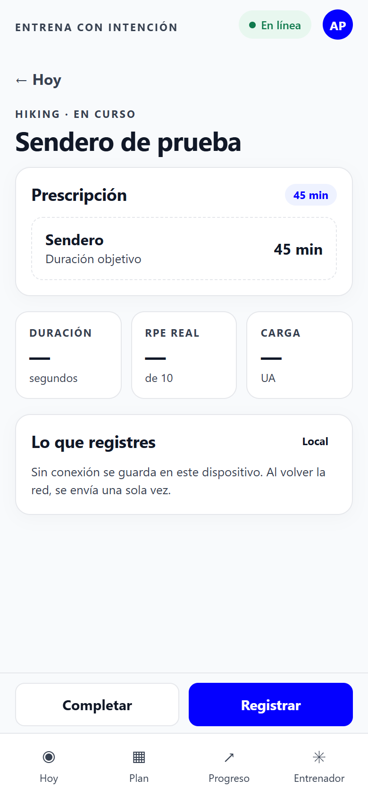
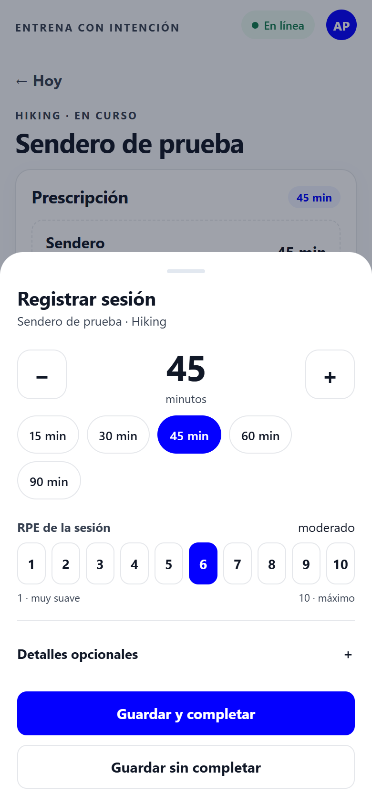
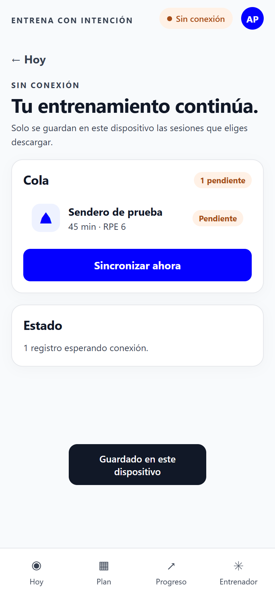
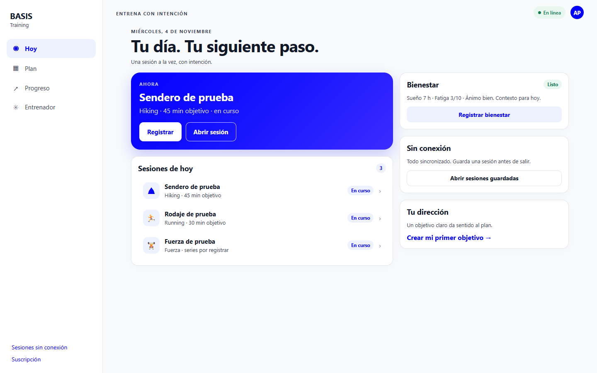
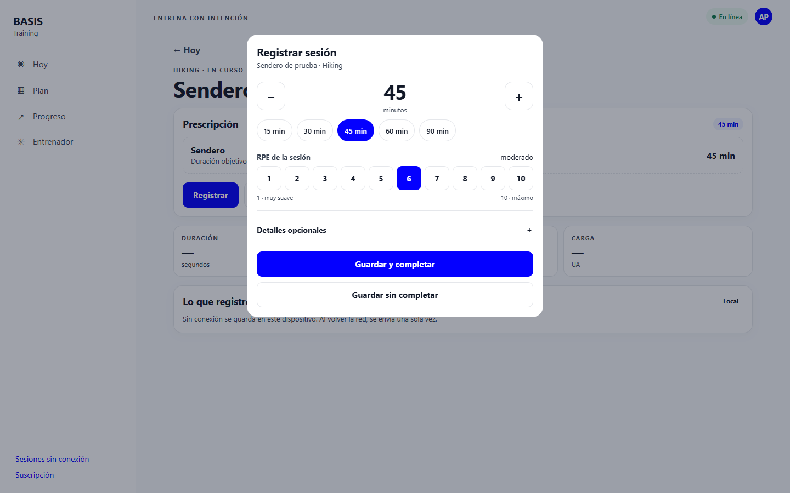

# Propuesta UI/UX — BASIS Training

**Fecha:** 2026-11-04 · **Estado:** en implementación · **Fase 1 desplegada en staging**

Propuesta de rediseño de las pantallas de uso diario, pensada para móvil y PC con la
misma base de componentes. Incluye un prototipo navegable:

- **Prototipo:** [mockup/propuesta.html](mockup/propuesta.html) — ábrelo en el navegador.
- **Capturas:** [mockup/screens/](mockup/screens/).

## Cómo revisarlo

1. Abre `mockup/propuesta.html` en Chrome o Safari.
2. Estrecha la ventana hasta ~390 px (o ábrelo en el teléfono) para ver la versión móvil;
   con la ventana ancha verás la de PC.
3. Toca el chip **En línea** para simular que no hay red; verás el estado offline.
4. Toca **Registrar** en la tarjeta azul: se abre la hoja de registro.
5. Elige minutos y RPE, guarda y observa la cola de “Sin conexión”.

Es un prototipo de interacción, no la app: los datos son ficticios y no hay servidor.

## La idea en cinco puntos

1. **Una acción primaria por pantalla.** Hoy: *Registrar*. Sesión: *Registrar*. Nada compite
   con eso.
2. **Registrar en menos de 10 segundos.** Duración y RPE primero; el resto de métricas
   detrás de “Detalles opcionales”.
3. **El estado siempre visible.** En línea / sin conexión, guardado aquí, pendiente de
   sincronizar, sincronizado. Sin adivinar.
4. **Una sola lista de sesiones.** Se acaba la duplicación entre “Hoy cuenta” y “Últimas
   sesiones”.
5. **Misma app en móvil y PC.** En móvil, barra inferior y hoja deslizante; en PC, barra
   lateral y diálogo centrado. Los componentes son los mismos.

## Diagnóstico

Detectado usando la app en un iPhone 11 real. La prueba funcional pasó (instalar, modo
avión, reabrir, sincronizar), pero la interfaz no acompaña.

| # | Problema | Efecto |
| --- | --- | --- |
| 1 | El editor offline muestra 20+ campos en una columna | Registrar cansa; lo importante se pierde entre métricas |
| 2 | Los botones de guardar y completar quedan al final del scroll | Se pueden quedar debajo de la barra inferior |
| 3 | Casi todo recarga la página entera | Se siente estático, sin confirmación inmediata |
| 4 | Hoy repite la misma sesión en dos bloques | Ruido y scroll innecesario |
| 5 | En móvil, “Sesiones sin conexión” desaparece del menú | Solo se llega por una tarjeta del final |

## Principios

- **Móvil primero, PC después**, pero el PC no es una versión pobre: aprovecha el ancho con
  dos columnas y acciones visibles.
- **Progressive disclosure:** lo obligatorio a la vista; lo opcional, a un toque.
- **Feedback inmediato:** cada acción responde en menos de 100 ms aunque el servidor tarde.
- **Offline no es un modo aparte:** es un estado visible de la misma pantalla.
- **Nada inventado:** los valores no registrados siguen desconocidos; el objetivo no se
  copia a lo ejecutado.
- **Toque cómodo:** controles de 44 px mínimo, separación de 8 px.
- **Accesible:** foco visible, etiquetas reales, estado no solo por color, movimiento
  reducido.

## Flujo principal

```
Hoy ──► Registrar (hoja) ──► Guardado local ──► Sesión (estado)
 │                                  │
 │                                  └─► Sin conexión: cola visible
 └─► Sesión ──► Registrar            └─► Con red: sincroniza sola
```

## Pantallas

### Hoy (móvil)



- Una tarjeta **Ahora** con la sesión en curso y dos acciones: *Registrar* (primaria) y
  *Abrir sesión*.
- **Una** lista de sesiones de hoy, con estado en píldora.
- Bienestar y “Sin conexión” como tarjetas secundarias, sin competir.
- La tarjeta de instalación desaparece cuando la app ya está instalada.

### Sesión (móvil)



- Prescripción legible en minutos, no en segundos.
- Tres cifras: duración, RPE, carga. Vacías hasta que registres.
- **Barra de acción fija** sobre la navegación: *Completar* (secundaria) y *Registrar*
  (primaria). Nunca queda debajo de la barra inferior.

### Registrar (móvil)



- Minutos con − / + y atajos 15/30/45/60/90.
- RPE en una escala de 10 botones, con palabra (“moderado”).
- “Detalles opcionales” para distancia, pulso y notas.
- *Guardar y completar* como primaria; *Guardar sin completar* como secundaria.
- Si no hay red, aparece el aviso “se guarda en este dispositivo”.

### Sin conexión (móvil)



- Cola con estado por sesión y un botón *Sincronizar ahora*.
- Cuando vuelve la red, el estado cambia sin recargar.

### PC





- Barra lateral con la navegación completa, incluida *Sesiones sin conexión*.
- Contenido en dos columnas: sesión a la izquierda, contexto a la derecha.
- El registro es un diálogo centrado, no una hoja.

## Responsive

| Elemento | Móvil (<1024 px) | PC (≥1024 px) |
| --- | --- | --- |
| Navegación | Barra inferior de 4 pestañas | Barra lateral fija |
| Acción de sesión | Barra fija sobre la nav | Botones en la cabecera de la tarjeta |
| Registro | Hoja deslizante desde abajo | Diálogo centrado de 540 px |
| Contenido | Una columna | Dos columnas, 1120 px máximo |
| Descarga offline | Desde Hoy y desde la hoja | Enlace permanente en la barra lateral |

Puntos de corte: 600 px (formularios a dos columnas), 1024 px (barra lateral).

## Componentes y tokens

Se reutilizan los tokens actuales (`tokens.css`): azul `#0400ff`, fondo `#f8fafc`,
superficie blanca, borde `#e5e7eb`, radios 10/16/22, tipografía del sistema.

Nuevos o formalizados: píldora de estado, barra de acción fija, hoja/diálogo, escala RPE,
atajos de duración, aviso de estado de red, toast. Todos con estados normal, foco,
presionado y deshabilitado.

## Accesibilidad y offline

- Controles de 44 px y etiquetas visibles; la escala RPE tiene `aria-label` por botón.
- El estado no depende solo del color: píldoras con texto (“En curso”, “Pendiente”).
- Foco visible con el anillo actual; la hoja se cierra con Escape y devuelve el foco.
- `prefers-reduced-motion` desactiva las animaciones de la hoja.
- Offline: la cola se muestra siempre; guardar nunca bloquea; el error de sincronización no
  borra datos locales.

## Plan de implementación

Cada fase es una entrega revisable por separado, sin cambiar el contrato deportivo.

| Fase | Qué | Criterio de aceptación |
| --- | --- | --- |
| **F9.1** | Hoja de registro rápida (duración + RPE + detalles) | Registrar una sesión en ≤ 3 toques; los campos opcionales no estorban |
| **F9.2** | Barra de acción fija en sesión | Los dos botones son visibles sin scroll y no quedan bajo la nav |
| **F9.3** | Guardado sin recarga con HTMX y estado visible | Guardar no recarga; se ve “guardado” y “pendiente”; sin red se encola |
| **F9.4** | Limpiar Hoy | Una sola lista; sin duplicados; instalación colapsada si ya está |
| **F9.5** | Navegación móvil | Espacio inferior correcto; acceso a “Sesiones sin conexión” sin buscar |

Archivos previstos: `training/execution/today.html`, `session.html`,
`shared/base.html`, `basis/css/app.css`, `tokens.css`, `basis/js/offline.js` y una ruta de
guardado reutilizada. Sin migraciones y sin cambios en el contrato.

Nota de limpieza: `scripts/browser_smoke.py` y `scripts/ux_acceptance.py` todavía prueban
el tema oscuro; hay que quitarles esa matriz al implementar F9.

## Lo que no cambia

- La regla de carga, las unidades y los campos del contrato deportivo.
- Que un valor no registrado sigue desconocido; no se rellena desde el objetivo.
- La inmutabilidad del historial y las versiones.
- La cola offline y la sincronización idempotente.
- Las URLs actuales; se puede navegar sin JavaScript (el formulario completo sigue).

## Implementado — 2026-11-04

- **Modo oscuro fuera:** botón, script, preferencia y tokens eliminados; la app queda
  siempre en claro.
- **Editor offline compacto:** duración y RPE primero, carga estimada en vivo, métricas por
  bloque dentro de “Detalles por bloque (opcional)” y dos botones grandes
  (*Completar sesión* primario, *Guardar registro* secundario).
- **Pruebas:** la prueba de navegador multisport sigue pasando; se actualizó para abrir el
  detalle antes de rellenar los campos por bloque.
- **Staging:** los archivos se copiaron al checkout de `app.basisasesoria.fitness` para
  revisarlo en el iPhone. Falta el commit y el PR.

Pendiente de esta fase: la hoja rápida en la sesión en línea, limpiar Hoy y la navegación
móvil.

## Plan, Progreso y Entrenador — qué hace cada botón

El prototipo incluye las tres rutas. Cada acción responde con estado visible, no con
silencio.

### Plan

| Botón | Qué hace | Feedback |
| --- | --- | --- |
| ← / → | Cambia de semana | “Cargando semana…” y luego la semana cargada; sin recargar la página |
| Hoy | Vuelve a la semana actual | La misma línea de estado |
| Día de la semana | Muestra las sesiones de ese día debajo | El día queda marcado y el panel dice “Mostrando miércoles 5” |
| Añadir sesión | Abre la hoja con nombre, disciplina, minutos y día | Si falta nombre o duración, aviso en el campo; al guardar, “Sesión añadida al plan” |
| Guardar sesión | Crea la sesión en una versión nueva | Cierra la hoja, aparece la sesión y cambia el estado |
| Editar (sesión) | Abre el editor de esa sesión | — |
| Añadir ciclo | Abre el editor de ciclos | — |
| Comparar con v2 | Muestra el antes/después | Panel con el diff y “Comparación calculada” |

### Progreso

| Botón | Qué hace | Feedback |
| --- | --- | --- |
| 7 días / 30 días / Semana / Rango / Todo | Cambia el período | “Actualizando…” y luego “Datos del período: …”; toast “Progreso actualizado” |
| Registrar bienestar | Abre el formulario de sueño, fatiga y disposición | — |
| Registrar peso | Abre el formulario de peso | — |
| Exportar mis datos | Prepara el archivo | Botón “Preparando…”, deshabilitado; después “Archivo listo” |
| Cómo se calcula | Explica cobertura y unidades | Se despliega en la misma tarjeta |

### Entrenador

| Botón | Qué hace | Feedback |
| --- | --- | --- |
| Consultar entrenador | Envía la consulta con el contexto | Deshabilitado sin texto; al pulsar, “Enviando…” con spinner; luego tarjeta “Preparando respuesta…” con contador de segundos |
| Cancelar (consulta) | Cancela solo antes de empezar | “Cancelada · reserva recuperada” y aviso de estado |
| Revisar propuesta | Abre la revisión antes de aplicar | La propuesta nunca se aplica sola |
| Cuota | Muestra consultas y costo del período | Barra y texto “3 de 5 consultas” |

### Feedback que falta en la app actual

- Guardar no dice nada visible: debe mostrar “Guardado” o “Pendiente”.
- Los botones no se deshabilitan ni muestran progreso al enviar.
- Los errores de formulario no se resumen junto al botón.
- Los cambios de período y de semana no indican que están cargando.
- Las listas vacías no explican qué hacer después.

## Decisiones aprobadas — 2026-11-04

1. **La acción principal de Hoy abre la hoja rápida.** “Abrir sesión” queda como acción
   secundaria para ver la prescripción completa.
2. **No se exige duración ni RPE para completar.** Se pueden dejar vacíos; si se intenta
   completar sin datos, se pide una confirmación breve, no se bloquea.
3. **Cuatro pestañas en móvil.** *Sin conexión* se abre desde el chip de estado de red y
   desde la tarjeta de Hoy, no ocupa una pestaña.
4. **Modo oscuro fuera.** Se quitan el botón, la preferencia guardada y los estilos.
5. **Orden de implementación:** F9.2 + F9.1 → F9.3 → F9.4 → F9.5.

Aclaración importante sobre los datos: la duración y el RPE son de **toda** la sesión, no
solo de gimnasio. De ahí sale la carga (minutos × RPE) para cualquier deporte. Lo que
cambia por disciplina son los campos del bloque (series y kilos en fuerza; distancia y
ritmo en running; desnivel en hiking). Esos son los opcionales que se esconden en
“Detalles”.

## Riesgos

- Cambiar la pantalla de sesión toca el flujo que ya funciona en iPhone; conviene hacerlo
  por fases y con la prueba offline como red de seguridad.
- La hoja rápida no debe romper el formulario completo: los campos avanzados siguen
  disponibles.
- El guardado sin recarga necesita una ruta que devuelva el estado; si falla, el formulario
  clásico debe seguir funcionando.
